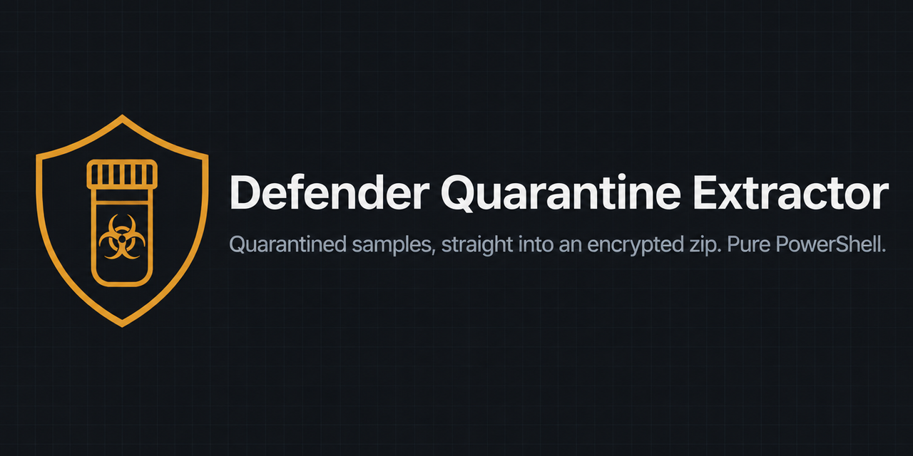
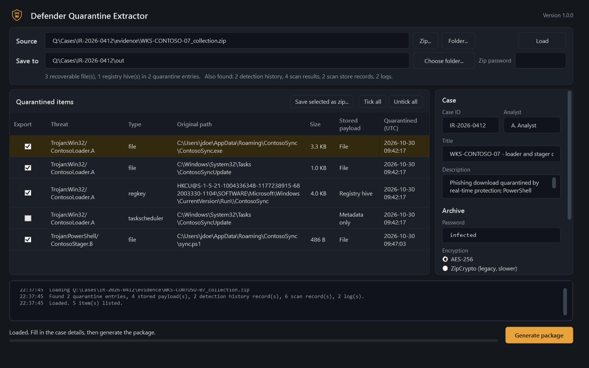
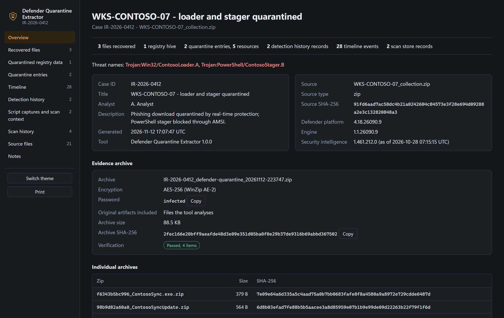
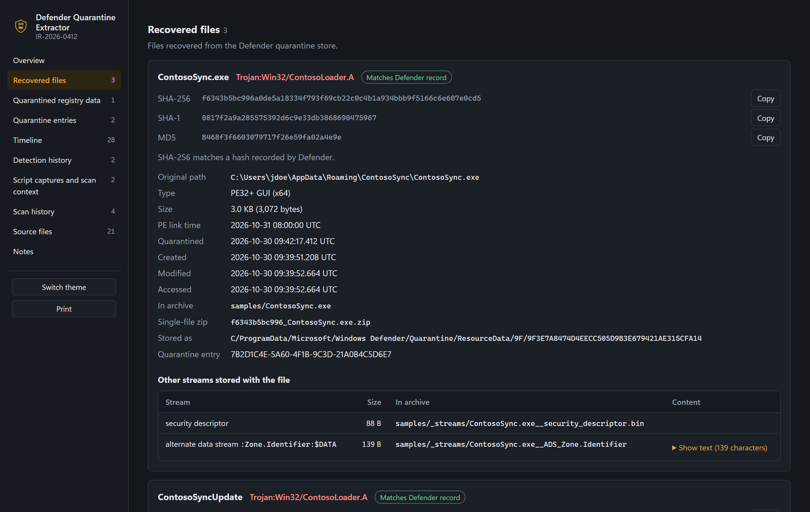
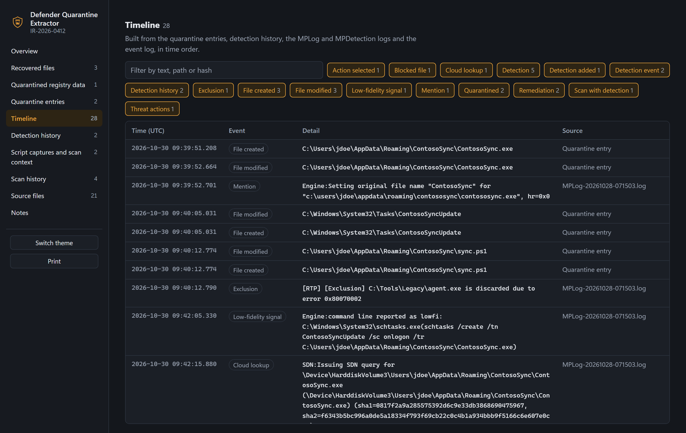
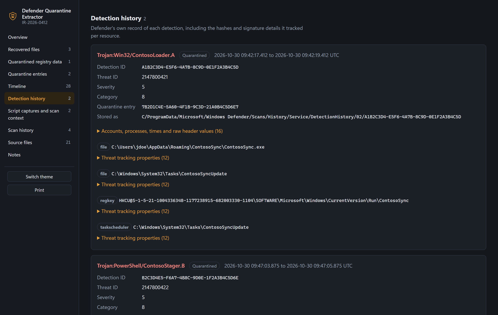

<p align="center">
  
</p>

# Defender Quarantine Extractor

<p>
  <a href="https://github.com/akhil-dara/Defender-Quarantine-Extractor/actions/workflows/ci.yml"></a>
  
  
  
  <a href="LICENSE"></a>
</p>

**Defender Quarantine Extractor** recovers files quarantined by **Microsoft Defender Antivirus** and **Microsoft Defender
for Endpoint (MDE)** from collected evidence, and writes them directly into a **password-protected zip** (AES-256,
password `infected`). It also decodes the related Defender artifacts (quarantine entries, DetectionHistory, scan
history, AMSI script captures, MPLog, MPDetection and the operational event log) into a timeline and an offline HTML
report.

It is a single PowerShell script with a graphical interface and a command-line mode. It needs no installation,
modules or compiled components, and it can be pasted into PowerShell ISE. Decrypted content is held in memory and
written only into the encrypted archive, so the tool can be used on an analyst workstation protected by Defender
without exclusions or disabling protection.

<p align="center">
  
</p>

## Contents

- [Features](#features)
- [Requirements](#requirements)
- [Getting started](#getting-started)
- [Command-line usage](#command-line-usage)
- [Supported input](#supported-input)
- [Output](#output)
- [HTML report](#html-report)
- [Frequently asked questions](#frequently-asked-questions)
- [How it works](#how-it-works)
- [Security considerations](#security-considerations)
- [Troubleshooting](#troubleshooting)
- [Development](#development)
- [Related projects](#related-projects)
- [Support](#support)
- [License](#license)

## Features

**Recovery**
- Decrypts Defender quarantine (`Quarantine\Entries` and `Quarantine\ResourceData`) and restores original file names
  and timestamps.
- Recovers alternate data streams, including `Zone.Identifier` with the download URL, extended attributes and
  security descriptors.
- Exports quarantined registry keys and services as registry hive files.
- Lists every quarantined resource, including metadata-only items such as scheduled tasks.

**Output**
- Writes an AES-256 (WinZip AE-2) or ZipCrypto archive directly, then reads it back to verify every recovered file.
- Optionally writes one archive per recovered file, and can export a single item from the list.
- Records case ID, analyst, title and description in the archive manifest and the report.

**Analysis**
- Parses DetectionHistory, scan results, the scan history store (AMSI script captures and scan context), MPLog,
  MPDetection and Defender event log files.
- Builds one timeline across all sources.
- Compares each recovered file's hashes with the hashes Defender recorded.

**Input handling**
- Accepts collection archives or folders in any layout, nested archives, password-protected archives and several
  sources at once. See [Supported input](#supported-input).

## Requirements

- Windows 10, Windows 11 or Windows Server 2016 and later
- Windows PowerShell 5.1 or PowerShell 7
- PowerShell in FullLanguage mode (sessions restricted to Constrained Language Mode are not supported)
- No administrator rights, internet access or additional modules

## Getting started

### Option 1: paste into PowerShell ISE

1. Open [`Defender-Quarantine-Extractor.ps1`](Defender-Quarantine-Extractor.ps1) and copy its full content
   (the **Raw** view is easiest).
2. In PowerShell ISE, open a new script tab (Ctrl+N), paste and press **F5**.

### Option 2: run the script file

```powershell
powershell -ExecutionPolicy Bypass -File .\Defender-Quarantine-Extractor.ps1
```

Files downloaded from the internet may be blocked by Windows; run `Unblock-File .\Defender-Quarantine-Extractor.ps1`
first if needed.

### Using the window

1. Select the collected archive (**Zip...**) or an extracted folder (**Folder...**), or drop it onto the window, then
   select **Load**.
2. Review the quarantined items and clear any you do not want to export.
3. Enter the case details and archive options.
4. Select **Generate package**. The archive and the report are written to the folder in **Save to**.

To export one item on its own, select it in the list and choose **Save this file as zip...**.

## Command-line usage

Supplying `-Source` runs the tool without the window. It returns an object describing the result, so it can be used
in scripts and pipelines.

```powershell
.\Defender-Quarantine-Extractor.ps1 -Source .\WKS-0412_collection.zip -CaseId IR-2026-0412 -PerFileZip
```

```powershell
# Process two collections together and keep only decoded results and recovered files
.\Defender-Quarantine-Extractor.ps1 -Source D:\Evidence\host1, D:\Evidence\host2.zip -OutputDirectory D:\Cases\0412 -IncludeOriginals None

# Process every collection in a folder
Get-ChildItem D:\Collections\*.zip | ForEach-Object {
    .\Defender-Quarantine-Extractor.ps1 -Source $_.FullName -OutputDirectory D:\Output
}
```

| Parameter | Default | Description |
|---|---|---|
| `-Source` | | One or more archives (`.zip`, `.gz`) or folders. Selects command-line mode. |
| `-OutputDirectory` | Current directory | Destination for the archive and report. |
| `-Password` | `infected` | Password for the output archive. |
| `-Encryption` | `AES256` | `AES256` or `ZipCrypto`. Use ZipCrypto only for tools that cannot open AES archives. |
| `-IncludeOriginals` | `Core` | Original files copied under `raw/`: `Core` (the files the tool analyses), `All` (everything in the source) or `None`. See [What is read](#what-is-read-from-a-defender-folder). |
| `-SourcePassword` | | Passwords for protected input archives. `infected`, `malware`, `virus` and `password` are always tried. |
| `-CaseId`, `-Analyst`, `-Title`, `-Description` | | Case details for the report and file names. |
| `-PerFileZip` | Off | Also write one archive per recovered file. |
| `-SkipVerify` | Off | Skip verification of the written archive. |
| `-OpenReport` | Off | Open the report when finished. |

Full documentation: `Get-Help .\Defender-Quarantine-Extractor.ps1 -Full`

## Supported input

| Input | Supported |
|---|---|
| Collection archive (`.zip`) from any collection tool or script, in any folder layout | Yes |
| Gzip-compressed archive (`.gz`, including a zip inside) | Yes |
| Extracted folder at any level: collection root, `ProgramData`, `Windows Defender` or `Quarantine` | Yes |
| Defender files copied without their folder structure | Yes, identified by content |
| Archives nested inside archives (up to four levels) | Yes |
| Password-protected archives (ZipCrypto or AES) | Yes |
| Several sources in one run | Yes |
| Defender event log (`.evtx`) in a folder | Yes |
| Defender event log (`.evtx`) inside an archive | Copied to the output but not parsed. Extract the collection and load the folder to include it. |
| 7z, RAR or Deflate64 archives | No. Re-create them as standard zip archives. |

### What is read from a Defender folder

Defender keeps its data in `C:\ProgramData\Microsoft\Windows Defender`. Files are recognised wherever they appear in
the collection.

| Defender file | Location | Decoded | Copied to `raw/` by default | Copied with **Everything** |
|---|---|---|---|---|
| Quarantine entries, payloads and payload index | `Quarantine\Entries`, `ResourceData`, `Resources` | Yes | Yes | Yes |
| Detection history | `Scans\History\Service\DetectionHistory` | Yes | Yes | Yes |
| Scan results | `Scans\History\Results` | Yes | Yes | Yes |
| Scan history store (AMSI captures, scan context) | `Scans\History\Store` | Yes | Yes | Yes |
| Protection and detection logs | `Support\MPLog-*.log`, `Support\MPDetection-*.log` | Yes | Yes | Yes |
| Operational event log | `Microsoft-Windows-Windows Defender%4Operational.evtx` | Yes, from a folder | Yes | Yes |
| Scan history service logs | `Scans\History\Service\*.log` | No | Yes | Yes |
| Command-line scanner log | `MpCmdRun*.log` | No | Yes | Yes |
| Other support logs (device control, DLP, scan skip) | `Support\MPDeviceControl-*`, `MPDlpLog-*`, `MPScanSkip-*` | No | No | Yes |
| Support bundle and trace files | `Support\MPSupportFiles.cab`, `Support\MpWpp*.bin` | No | No | Yes |
| Scan cache | `Scans\History\CacheManager` | No | No | Yes |

**None** copies no original files: the archive holds only the recovered files and the decoded results.

## Output

```
<CaseId>_defender-quarantine_<timestamp>.zip        password protected
  samples/              recovered files with original names and timestamps
  samples/_streams/     alternate data streams, extended attributes, security descriptors
  registry/             quarantined registry keys and services as hive files
  decoded/              quarantine entries, detection history, scan results, scan store,
                        event log (JSON), samples.csv, timeline.csv
  raw/                  original Defender files as collected
  manifest.json         case details, hashes and processing notes
  report.html           HTML report
<CaseId>_defender-quarantine_<timestamp>.html       copy of the report
<CaseId>_defender-quarantine_<timestamp>_samples/   one archive per recovered file (optional)
```

## HTML report

The report is a single offline HTML file with no external requests. It supports light and dark themes and printing,
and includes copy buttons for hashes and a filterable timeline.

| Overview | Recovered files |
|---|---|
|  |  |

| Timeline | Detection history |
|---|---|
|  |  |

The report does not contain file content. Captured script text and command lines are stored masked within the page
and decoded by the browser when displayed.

## Frequently asked questions

**Where does Microsoft Defender store quarantined files?**
In `C:\ProgramData\Microsoft\Windows Defender\Quarantine`. `Entries` holds one metadata file per remediation and
`ResourceData` holds the quarantined content, both RC4-encrypted with a key that is the same on every Windows
installation.

**How do I extract a file from Defender quarantine without restoring it on the host?**
Collect the `Quarantine` folder with your usual collection tool or script, or copy it, and load the collection here. The
file is decrypted in memory and written into a password-protected archive; nothing is restored to its original
location.

**Which collection tools are supported?**
Any tool or script that copies the `Windows Defender` folder, or parts of it, as a zip, a gzip or a plain folder.
Folder names do not need to be preserved: Defender files are also recognised by their content.

**Does this need Defender to be disabled or excluded on the analysis machine?**
No. Decrypted content is never written to disk unencrypted, so real-time protection has nothing to act on.

**Which archive password is used?**
`infected` by default, the common convention for exchanging malware samples. It can be changed in the window or with
`-Password`.

**Does it modify the evidence?**
No. All sources are opened read-only.

## How it works

1. **Read.** Sources are indexed without extraction. Archives, including nested and password-protected ones, are read
   with a built-in zip reader. Defender artifacts are identified by path and, when names are missing, by content.
2. **Decrypt.** Quarantine and scan history files are decrypted with Defender's RC4 key. The keystream is derived once
   and applied with native .NET operations, which keeps large files fast in PowerShell.
3. **Decode.** Payloads are split into their backup streams. DetectionHistory, scan results, the scan history store,
   logs and event log entries are parsed and merged into a timeline.
4. **Write.** Each item is compressed and encrypted in memory, then appended to the output archive, which is verified
   by reading it back.

All file formats are documented in [docs/artifacts.md](docs/artifacts.md).

## Security considerations

- Recovered files are live malware. Open the archive only in an isolated analysis environment.
- Use the tool only on evidence you are authorised to handle.
- The default password `infected` prevents accidental execution and automatic scanning; it is not a secret. Use a
  different password when sharing outside your team.
- To report a vulnerability, see [SECURITY.md](SECURITY.md).

## Troubleshooting

| Message or symptom | Resolution |
|---|---|
| `The term '#requires' is not recognized`, or an unexpected character before the first line after pasting | The copied text contains a byte-order mark from another editor. Copy from the Raw view, or open the `.ps1` file in ISE. |
| `... needs FullLanguage mode` | The session is restricted by AppLocker or WDAC. Run the tool on a machine or session where scripts run in FullLanguage mode. |
| `... is password-protected and none of the passwords tried worked` | Enter the password in **Zip password**, or pass `-SourcePassword`. |
| `No Microsoft Defender artifacts were recognised` | The source does not contain `Quarantine`, `Scans\History` or `Support` data. Check the collection. |
| Items listed as **Metadata only** | Defender removed the item without storing content (for example a scheduled task registration). |

Every warning raised during processing is listed in the **Notes** section of the report.

## Development

The released script is assembled from the files in [`src/`](src):

```powershell
powershell -File build\Build.ps1                     # build Defender-Quarantine-Extractor.ps1
powershell -File tests\Invoke-Tests.ps1              # functional and security tests
powershell -File tests\Invoke-SecurityTests.ps1      # security tests only
powershell -STA -File build\Update-Screenshots.ps1   # regenerate docs\images
```

Tests and screenshots use synthetic evidence generated by
[`tests/New-DemoEvidence.ps1`](tests/New-DemoEvidence.ps1): a fictional host's Defender folder, written in eight
collection layouts with harmless payloads. The security tests add crafted evidence that tries to break the tool:
path-traversal entry names, script and formula injection, decompression bombs, size fields that lie, and fuzzed
artifacts; each bomb runs in its own process with its peak memory measured. See [CONTRIBUTING.md](CONTRIBUTING.md).

## Related projects

The Defender formats were first documented by others; this project is an independent PowerShell implementation.

- ERNW, *quarantine-formats*: original analysis of Defender quarantine encryption
- [knez/defender-dump](https://github.com/knez/defender-dump): Python, dumps quarantined files
- [NUKIB/maldump](https://github.com/NUKIB/maldump): Python, quarantine extraction for multiple antivirus products
- [jklepsercyber/defender-detectionhistory-parser](https://github.com/jklepsercyber/defender-detectionhistory-parser):
  Python, DetectionHistory parser
- [fox-it/dissect.target](https://github.com/fox-it/dissect.target): Python forensic framework with Defender plugins

## Support

If this tool saves you time, you can support its development:

<p>
  <a href="https://github.com/sponsors/akhil-dara"></a>
  <a href="https://buymeacoffee.com/akhildara1l"></a>
</p>

Bug reports and pull requests are equally welcome.

## License

Licensed under the [Apache License 2.0](LICENSE).

Microsoft, Windows and Microsoft Defender are trademarks of the Microsoft group of companies. This project is not
affiliated with or endorsed by Microsoft.
